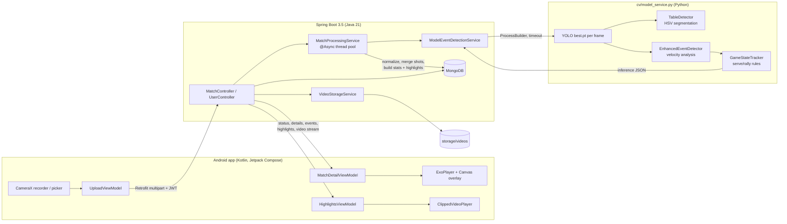

# AllanAI

Record a table-tennis match on an Android phone. A Spring Boot backend then runs a YOLO ball detector and a rules-based game-state tracker over the video and returns scores, rally events, shot speeds and highlight clips, which the app plays back in sync with the video.

<!--  -->
<!-- SHOT: hero.gif — Match detail screen playing a processed match: ball bounding box tracking on the video, live score and shot-speed cards updating, then a tap on an event in the timeline that jumps the video to that moment. 8–12 s. -->

## Overview

Casual and club players rarely have a way to review their own matches. AllanAI turns a single phone recording into structured match data. The app uploads the video, and the backend detects the ball frame by frame, applies table-tennis serve and rally rules to infer bounces, net hits and points, and stores the result in MongoDB. The app then shows the match with a synchronized ball overlay, running statistics and auto-generated highlight clips.

Built by a team of five. I was the lead backend contributor: I wrote the Spring Boot backend and auth, integrated the YOLO model into the processing pipeline, optimized the OpenCV stages, and built the visualizer. I also contributed to the Android app. <!-- TODO(Ayden): name the event or course, and adjust the role line if needed. -->

## Features

- **Record or upload**: record with CameraX inside the app, or pick an existing video, then upload it to the backend (multipart, up to 500 MB).
- **Automatic analysis**: ball detection, bounce and net-hit detection, serve and rally tracking, score keeping and shot-speed estimates.
- **Synced playback**: an ExoPlayer video with a Canvas overlay of ball bounding boxes and trajectory. The score, current shot and cumulative stats update as the video plays.
- **Event timeline**: tap a score, rally or fast shot to seek the video to that moment.
- **Highlights**: play of the game, top rallies, fastest shots and serve aces, each played as a looping clip cut from the match video.
- **Accounts**: sign up and sign in with JWT, edit your profile and change your password.
- **Match history**: list, view and delete processed matches, and see each one's processing status.

## Architecture



An upload returns `202 Accepted` with a match ID right away. Processing runs on a dedicated `ThreadPoolTaskExecutor`, and the match status moves through `PROCESSING` and then `COMPLETE` or `FAILED`. The Python model runs as a separate process and its only contract with the backend is a JSON file, so the CV code can change without touching the Java service.

## Engineering highlights

### 1. Turning per-frame ball boxes into game events
**Problem:** the detector only says where the ball is in each frame. Bounces, net hits and points have to be inferred from that.
**Approach:** `model_service.py` keeps the highest-confidence YOLO box per frame in a 40-frame history (`deque`). `_detect_bounce()` looks for a vertical velocity sign reversal (down, then up) across consecutive samples, with thresholds that scale with frame rate (30 fps vs. 60+ fps). Bounces less than 80 ms apart are debounced. `_detect_net_hit()` flags a sudden drop or reversal in horizontal velocity within 30 px of the net line at table height.
**Result:** each event carries its frame number, its timestamp in milliseconds, incoming and outgoing speed, shot type and confidence, which is enough to build event windows and highlights downstream.

### 2. A rules engine for scoring
**Problem:** a bounce only means something in the context of the rally (who served, and which side it last landed on).
**Approach:** `GameStateTracker` is an explicit state machine (`WAITING_FOR_SERVE` → `SERVE_IN_PROGRESS` → `RALLY_IN_PROGRESS` → `POINT_SCORED`). It checks a bounce against the table bounds and the expected side: a serve must land on the server's side and then the receiver's side, and a rally ball must alternate sides. A wrong-side or off-table bounce awards the point. The server switches every two points, and a rally is closed when the ball is missing for 30 frames.
**Result:** the score and rally lengths come out of the rules rather than being guessed from raw detections. <!-- TODO(Ayden): add accuracy vs. a hand-scored test video if you have one -->

### 3. Pixel-to-real-world speed estimation
**Problem:** speed in px/frame means nothing to a player.
**Approach:** `TableDetector` segments the table in HSV space (blue and green ranges), cleans the mask with morphological close and open, and takes the largest contour, rejecting it if it covers less than 10% of the frame. The bounds are cached for the whole match. Pixels-per-metre is derived from the table's known dimensions, and speed is EMA-smoothed and reported in km/h. If auto-detection fails, `table_calibration.py` lets you click the four table corners, and the result is passed in through `TABLE_BOUNDS`.
**Result:** each shot and the match summary have real-unit speeds (average and max), plus incoming and outgoing speeds per bounce.
<!-- TODO(Ayden): EnhancedEventDetector divides the table's horizontal pixel span by 1.525 m (the table WIDTH), but the net is placed at the horizontal midpoint, so that span is the 2.74 m LENGTH. Speeds may read about 1.8x high. Fix or confirm before quoting any speed numbers. -->


### 4. A Java ↔ Python inference boundary that fails cleanly
**Problem:** the model lives in Python (Ultralytics and PyTorch), while the API is Spring.
**Approach:** `ModelEventDetectionService` builds the command from a template in `application.properties`, with placeholders such as `{video}`, `{outputDir}`, `{matchId}`, `{weights}` and `{confidence}`. Before launching it, the service checks that the working directory and the script exist. It then runs the command with a configurable timeout (default 5 minutes), calls `destroyForcibly()` if the timeout is hit, and treats a non-zero exit code or a missing output file as a failure. The JSON is read into `ModelInferenceResult` and normalized.
**Post-processing** (`MatchProcessingService`): `condenseShots()` merges detections from the same player within 180 ms into one shot, `annotateShotsWithEvents()` aligns each event to the nearest shot within 250 ms, and `buildHighlights()` ranks events by importance to pick the play of the game, top rallies, fastest shots and serve aces.
**Result:** a model crash or hang marks one match as `FAILED` and leaves the API responsive.

### 5. Stats synced to video on Android
**Problem:** static summary numbers don't show *when* things happened.
**Approach:** `VideoPlayerWithOverlay` samples the ExoPlayer position every 50 ms. `MatchDetailViewModel.updateRealTimeStats()` finds the shot within ±50 ms and the event within ±200 ms of that position, reads the score from the momentum timeline, and recomputes the cumulative stats up to that point. A Compose `Canvas` scales the stored bounding boxes from video coordinates to display coordinates. Highlights use Media3 `ClippingConfiguration` to loop just the event window.
**Result:** the overlay, scoreboard and stats all follow scrubbing and seeking.

## Tech stack

| Layer | Technologies |
|---|---|
| Android | Kotlin, Jetpack Compose, Material 3, Hilt, Retrofit + OkHttp + Moshi, Media3 ExoPlayer, CameraX, Coil, Navigation Compose |
| Backend | Java 21, Spring Boot 3.5 (Web, Security, Data MongoDB, Validation), jjwt 0.12, BCrypt, OpenCV 4.9 (Java bindings, video metadata) |
| Computer vision | Python, Ultralytics YOLO (single-class ball detector, `best.pt`), PyTorch, OpenCV, NumPy |
| Storage | MongoDB (match and user documents), local filesystem (videos, inference JSON) |
| Tooling | Maven wrapper, Gradle (Kotlin DSL), a standalone HTML/JS visualizer for inference JSON (`backend/backend/visualizer/`) |

**Model and research credits:** the ball-detector weights come from the [ping-pong-deep-learning](https://github.com/ccs-cs1l-f24/ping-pong-deep-learning) project and were trained on the [OpenTTGames](https://lab.osai.ai/) dataset. The event-spotting design follows [TTNet](https://arxiv.org/abs/2004.09927) (Voeikov et al., CVPR 2020 Workshops). `best.pt` is committed at `backend/backend/cv/best.pt`; to regenerate it, train with the upstream repo as described in [docs/model-and-api.md](docs/model-and-api.md), which also covers the inference JSON contract and the REST endpoints. <!-- TODO(Ayden): confirm whether your team retrained best.pt or used the upstream weights as-is, and reword this line to match. -->

## Getting started

**Prerequisites:** JDK 21, MongoDB on `localhost:27017`, Python 3 with `pip` (the backend calls `python` on your `PATH`), and Android Studio with SDK 36.

```bash
# 1. CV dependencies
pip install -r backend/backend/cv/requirements.txt

# Optional: run the analyzer on its own
python backend/backend/cv/model_service.py match.mp4 out.json 0.25

# 2. Backend: set a JWT signing secret (required; the app refuses to start without one)
export ALLANAI_SECURITY_JWT_SECRET="$(openssl rand -base64 48)"

#    Build, then run from the REPO ROOT (paths in application.properties are relative to it)
(cd backend/backend && ./mvnw -DskipTests package)
java -jar backend/backend/target/backend-0.0.1-SNAPSHOT.jar   # serves on :8080

# 3. Android app: the backend URL defaults to http://10.0.2.2:8080/ (the emulator's alias
#    for your machine). On a physical device, point it at your machine's LAN IP:
echo "allanai.baseUrl=http://<your-lan-ip>:8080/" >> Frontend/local.properties
cd Frontend
./gradlew installDebug
```

**Configuration (names only):**
- Python: `YOLO_MODEL_WEIGHTS` (override the weights path), `YOLO_FALLBACK_MODEL` (used if `best.pt` is missing), `TABLE_BOUNDS` (JSON with manual table bounds).
- Spring: `ALLANAI_SECURITY_JWT_SECRET` (required, at least 32 bytes; it signs the JWTs, so keep it out of git) and optionally `SPRING_DATA_MONGODB_URI`.
- Android: `allanai.baseUrl` in `Frontend/local.properties` (git-ignored), compiled into `BuildConfig.BASE_URL`.
- If your interpreter is called `python3`, change `allanai.model.command[0]` in `application.properties`.

## Status

This is a working prototype. Known limitations:
- Matches are not yet scoped per user: any signed-in user can list every match.
- Table detection assumes a side-on camera and a blue or green table.
- The integration test (`MatchPipelineIntegrationTest`) predates the JWT security layer, and like the app it needs `ALLANAI_SECURITY_JWT_SECRET` set.
<!-- TODO(Ayden): confirm whether the integration test still passes now that JWT auth is required -->
