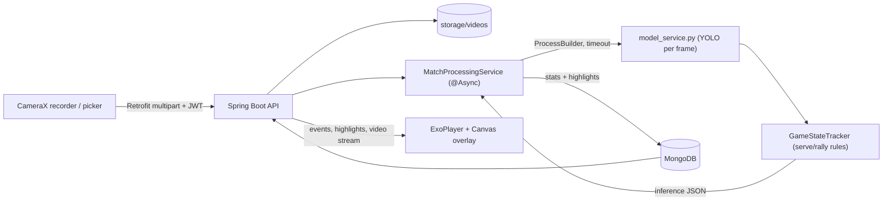

# AllanAI

Record a table-tennis match on an Android phone and get back the score, rally events, shot speeds and highlight clips. A Spring Boot backend runs a YOLO ball detector and a rules-based game-state tracker over the video, and the app plays the results back in sync with the footage.

<!--  -->
<!-- SHOT: hero.gif — Match detail screen playing a processed match: ball bounding box tracking on the video, live score and shot-speed cards updating, then a tap on an event in the timeline that jumps the video to that moment. 8–12 s. -->

Built by a team of five. I was the lead backend contributor: I wrote the Spring Boot backend and auth, integrated the YOLO model into the processing pipeline, optimized the OpenCV stages, and built the visualizer. I also worked on the Android app. <!-- TODO(Ayden): name the event or course, and adjust the role line if needed. -->

## How it works



An upload returns `202 Accepted` with a match ID right away. Processing runs on its own thread pool, and the match goes from `PROCESSING` to `COMPLETE` or `FAILED`. The Python model runs as a separate process and its only contract with the backend is a JSON file, so the CV code can change without touching the Java service.

## Interesting bits

- Getting events out of ball boxes. The detector only says where the ball is in each frame. `model_service.py` keeps the best box per frame in a 40-frame history and calls it a bounce when vertical velocity flips from down to up, with thresholds that scale with frame rate and an 80 ms debounce. A net hit is a sudden drop or reversal in horizontal velocity within 30 px of the net line.
- Scoring by the rules. `GameStateTracker` is a state machine (`WAITING_FOR_SERVE` → `SERVE_IN_PROGRESS` → `RALLY_IN_PROGRESS` → `POINT_SCORED`). A serve has to land on the server's side then the receiver's, a rally ball has to alternate sides, and a wrong-side or off-table bounce gives away the point. The server switches every two points, and a rally closes once the ball has been missing for 30 frames. <!-- TODO(Ayden): add accuracy vs. a hand-scored test video if you have one -->
- Speeds in km/h. `TableDetector` finds the table with HSV segmentation (blue or green), cleans the mask and takes the largest contour, then gets pixels-per-metre from the table's known dimensions. If detection fails, `table_calibration.py` lets you click the four corners and passes them in through `TABLE_BOUNDS`.
<!-- TODO(Ayden): EnhancedEventDetector divides the table's horizontal pixel span by 1.525 m (the table WIDTH), but the net is placed at the horizontal midpoint, so that span is the 2.74 m LENGTH. Speeds may read about 1.8x high. Fix or confirm before quoting any speed numbers. -->
- Failing cleanly between Java and Python. `ModelEventDetectionService` builds the command from a template in `application.properties`, checks the script exists, runs it with a timeout (5 minutes by default) and calls `destroyForcibly()` if it hangs. A crash, non-zero exit or missing JSON marks that one match `FAILED` and the API keeps responding. Afterwards `MatchProcessingService` merges detections within 180 ms into one shot, aligns events to shots within 250 ms and ranks events to pick the highlights.
- Stats that follow the video. `VideoPlayerWithOverlay` samples the ExoPlayer position every 50 ms, and `MatchDetailViewModel` finds the nearby shot and event, the score at that point and the cumulative stats so far. A Compose `Canvas` scales the stored boxes onto the video, so scrubbing moves the overlay, scoreboard and stats together. Highlights loop just the event window with Media3 `ClippingConfiguration`.

Credits: the ball-detector weights come from the [ping-pong-deep-learning](https://github.com/ccs-cs1l-f24/ping-pong-deep-learning) project and were trained on the [OpenTTGames](https://lab.osai.ai/) dataset. The event-spotting design follows [TTNet](https://arxiv.org/abs/2004.09927) (Voeikov et al., CVPR 2020 Workshops). `best.pt` is committed at `backend/backend/cv/best.pt`; [docs/model-and-api.md](docs/model-and-api.md) covers retraining it, the inference JSON contract and the REST endpoints. <!-- TODO(Ayden): confirm whether your team retrained best.pt or used the upstream weights as-is, and reword this line to match. -->

## Running it

You need JDK 21, MongoDB on `localhost:27017`, Python 3 (the backend calls `python` on your `PATH`) and Android Studio with SDK 36.

```bash
# CV dependencies (and optionally run the analyzer on its own)
pip install -r backend/backend/cv/requirements.txt
python backend/backend/cv/model_service.py match.mp4 out.json 0.25

# Backend: the JWT secret is required. Run the jar from the REPO ROOT.
export ALLANAI_SECURITY_JWT_SECRET="$(openssl rand -base64 48)"
(cd backend/backend && ./mvnw -DskipTests package)
java -jar backend/backend/target/backend-0.0.1-SNAPSHOT.jar   # serves on :8080

# Android: defaults to http://10.0.2.2:8080/ (the emulator). On a real phone, use your LAN IP:
echo "allanai.baseUrl=http://<your-lan-ip>:8080/" >> Frontend/local.properties
cd Frontend && ./gradlew installDebug
```

- `ALLANAI_SECURITY_JWT_SECRET` must be at least 32 bytes; keep it out of git. `SPRING_DATA_MONGODB_URI` is optional.
- Python reads `YOLO_MODEL_WEIGHTS`, `YOLO_FALLBACK_MODEL` (used if `best.pt` is missing) and `TABLE_BOUNDS`.
- If your interpreter is `python3`, change `allanai.model.command[0]` in `application.properties`.

Known gaps: matches aren't scoped per user yet (any signed-in user can list every match), table detection assumes a side-on camera and a blue or green table, and `MatchPipelineIntegrationTest` predates the JWT layer (it also needs the secret set). <!-- TODO(Ayden): confirm whether the integration test still passes now that JWT auth is required -->

Stack: Kotlin, Jetpack Compose, Hilt, Retrofit, Media3 ExoPlayer, CameraX, Java 21, Spring Boot 3.5, jjwt, MongoDB, Python, Ultralytics YOLO, PyTorch, OpenCV.
